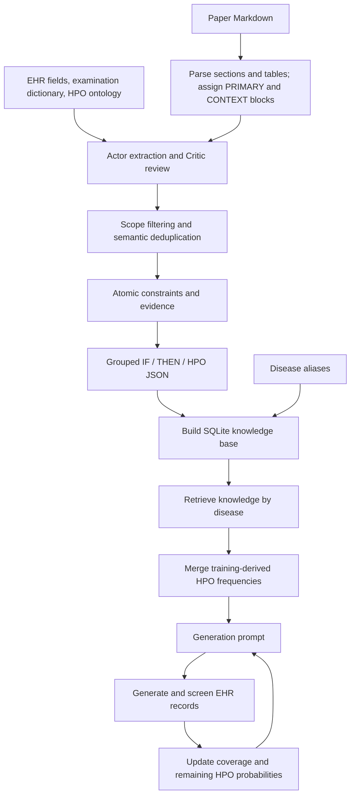

# Building Clinical Knowledge from Literature

This workflow extracts disease–examination and disease–phenotype relations from paper Markdown, preserves their evidence, and builds the SQLite knowledge base used by Curasyn.



## Setup and inputs

Use Python 3.10 and install the dependencies in the repository's `requirements.txt`, as described in the [installation instructions](../../README.md#installation). Run preparation commands from this directory:

```bash
cd constraintKB/create_kb
cp config.example.json config.json
```

Fill in `config.json`. The paper, EHR, dictionary, and model settings need local values. The example points to the bundled ontology and EHR vocabulary. Relative paths resolve against the working directory; absolute paths are also supported.

| Setting | Required value |
| --- | --- |
| `inputs` | List of Markdown file paths; initially `[]`. Positional CLI paths override this list. |
| `ehr_path` | CSV defining the examination fields available for extraction. Only its field layout is used to define examination scope. |
| `dictionary_path` | CSV describing examination fields and units. |
| `hpo_path` | HPO OBO file; the included ontology is available at `../ontology/hp.obo`. |
| `hpo_vocabulary_path` | Required fixed task vocabulary JSON. For EHR, use `../ontology/ehr_hpo_vocabulary.json`, matching main synthesis. |
| `actor_model` / `critic_model` | Model IDs for extraction and review. |
| `base_url` | OpenAI-compatible Chat Completions endpoint, including `/v1`. |
| `api_key_env` | Name of the credential environment variable; defaults to `OPENAI_API_KEY`. |

The EHR field layout and examination dictionary define the allowed examination targets. The vocabulary file and ontology define allowed HPO targets. Disease relations and frequencies come from the papers. Use the same examination fields and fixed HPO vocabulary as the generation task. Training and test records do not define separate vocabularies.

The canonical EHR format uses `hpo_codes`, containing JSON string arrays such as `["HP:0033834"]`, and examination columns defined in `src/ehr_contract.py`. The dictionary matches fields by name:

```csv
field,meaning,unit
absolute_neutrophil_count,Absolute neutrophil count,K/uL
immunoglobulin_g,Immunoglobulin G,mg/dL
```

This is a format example. Supply an entry for every canonical examination column present in the EHR input. Fields must be unique, and field names, meanings, and units must be nonempty. The dictionary describes the units of the supplied CSV. For a panel produced by the MIMIC tool, use its [output units](../../datasets/README.md#examination-fields-and-units); for example, its immunoglobulin columns are in g/L. A [three-field dictionary example](../../datasets/examples/examination_dictionary_example.csv) accompanies the fictional EHR CSV.

The alternative input format uses `phenotype__hpo_codes` and `examination__*` columns with a `cleaned_field,meaning,data_type,unit` dictionary. In this format, examination counts, ordering, and meanings must agree. For canonical input, extraction represents examination targets internally as `examination__<canonical field name>`.

Prepare paper Markdown before running this workflow. Local `config.json`, `inputs/`, and `runs/` are excluded from version control.

## Extraction settings

Literature extraction is configured independently of main synthesis. Its example configuration retains these defaults:

| Setting | Default |
| --- | --- |
| Actor / Critic models | Required user-supplied model IDs |
| Endpoint | `https://api.openai.com/v1`; configurable |
| Credential environment variable | `OPENAI_API_KEY` |
| Response format | `json_schema` |
| Temperature | `null` (not sent to the service) |
| Concurrent jobs / maximum Actor rounds | 6 / 3 |
| Initial maximum output tokens / timeout | 12,000 / 180 seconds |
| Revision maximum output tokens / timeout | 10,000 / 360 seconds |
| Request retries / revision retries | 3 / 1 |
| Chunk characters / context overlap blocks | 12,000 / 2 |

The Actor/Critic model versions and original literature input set used to produce the bundled knowledge are not recorded in the example configuration. For synthesis using the supplied knowledge, read the included database directly. For a new literature run, retain the Markdown inputs, EHR scope, examination dictionary, ontology, model revisions, and run manifest. The manifest records the extraction configuration and scope input checksums.

Use `python -B run.py run --help` for model, endpoint, concurrency, and preprocessing overrides. Relative input/output paths use the current working directory, including when the configuration file is elsewhere; the commands below assume `constraintKB/create_kb/`.

## Preprocessing and extraction

After setting `inputs`, inspect preprocessing without a model service or scope data:

```bash
python -B run.py preprocess --config config.json --output runs/preprocess-check
```

The parser handles headings, paragraphs, and Markdown/HTML tables, retaining source lines and block IDs. It excludes predefined sections such as references. Each eligible block appears exactly once as PRIMARY; nearby blocks and headings may provide CONTEXT. Inspect coverage statistics in `preprocess_manifest.json` and chunks in `documents/*/chunks.jsonl`.

Set the credential environment variable named by `api_key_env`, then run extraction:

```bash
python -B run.py run --config config.json --output runs/experiment-001
```

For a local service without authentication, set `require_api_key` to `false`. Model and endpoint precedence is CLI arguments, environment variables (`CONSTRAINT_ACTOR_MODEL`, `CONSTRAINT_CRITIC_MODEL`, `OPENAI_BASE_URL`), then configuration. Missing input paths cause an error before model requests.

Each chunk creates separate examination and phenotype jobs. The Actor returns candidates; the Critic checks errors and omissions. A `pass` ends review early, while `revise` requests another round. Defaults are six concurrent jobs and three rounds.

Extraction distinguishes strong and weak relations. Weak relations describe findings that may occur in some patients. Scope filtering removes unsupported targets, mismatched source expressions, normal states, and normal reference ranges. Semantic deduplication merges repeated evidence.

Identical requests can reuse the `calls/` cache. Rerunning still preprocesses and aggregates results; changed inputs, models, or parameters may trigger new requests. Use a separate output directory for each experiment. Run one experiment per process.

## Artifacts and JSON export

| Artifact | Contents |
| --- | --- |
| `constraints.jsonl` | Atomic relations with disease, target, assertion, strength, role, population, logic, and evidence. |
| `constraints.compact.jsonl` / `constraint_evidence.jsonl` | Grouped views and referenced evidence text. |
| `scope_excluded_constraints.jsonl` | Excluded candidates and reasons. |
| `actor_critic_results.jsonl` | Final candidates, review feedback, and revision traces for each job. |
| `manifest.json` / `errors.jsonl` | Configuration, execution status, counts, scope input checksums, and errors. |
| `documents/` | Document metadata, blocks, chunks, and per-job results. |
| `calls/` | Request/response and usage cache, excluding API keys. |

Check the run manifest and errors, then export:

```bash
python -B run.py export \
  --input runs/experiment-001/constraints.jsonl \
  --output runs/experiment-001/constraints.json
```

Export reads the atomic relations from the specified JSONL file.

```json
{
  "constraints": {
    "1": {
      "IF": "Example disease",
      "THEN": [{"CONSTRAINT": "IgG < 500 mg/dL", "STRENGTH": "sometimes"}],
      "HPO": [{"CONSTRAINT": "HPO:0033834 - Malaise", "STRENGTH": "sometimes"}]
    }
  }
}
```

Export rules:

1. Group by exact `disease.name`, assign string IDs, and omit empty THEN/HPO arrays.
2. Export `disease_test_value` to THEN only when a numeric comparison or interval can be rendered. Direction-only findings such as low/high/abnormal count toward `dropped_tests`.
3. Export `disease_phenotype` to HPO, changing the display prefix from `HP:` to `HPO:`.
4. Set `STRENGTH` from nonempty `assertion.frequency`, then certainty, then strong/weak. The field retains the source wording.
5. Keep only `CONSTRAINT` and `STRENGTH` per item. Preserve the original JSONL for evidence, negation, population, timing, and AND/OR semantics omitted by this simplified format.

The command reports input, retained, dropped-test, disease-group, THEN, and HPO counts. Invalid input causes an error without replacing an existing output file.

## Database construction

Build a candidate database using the disease alias mapping:

```bash
python -B run.py build \
  --source runs/experiment-001/constraints.json \
  --mapping ../disease_mapping.csv \
  --output runs/experiment-001/clinical_knowledge.sqlite
```

The command calls `constraintKB/build_kb.py`. Successful construction atomically replaces the specified output file if it already exists.

| Input | Database representation |
| --- | --- |
| `IF` | Disease resolved through `canonical_name,iuis_table,aliases`; aliases are separated by `\|`. Unmapped names become separate disease nodes. |
| `HPO[].CONSTRAINT` | `HPO:<seven digits> - <name>` becomes a phenotype node and relation with a standard `HP:` code. |
| `THEN[].CONSTRAINT` | Complete statement retained; examination patterns identify targets such as ANC → `examination__anc`. |
| `STRENGTH` | Stored as `strength_text`. |
| Group ID | Stored as `source_constraint_id`, referencing the grouped JSON record. |

SQLite schema version `1` contains `nodes`, `aliases`, `edges`, and `metadata`. Metadata includes the grouped JSON checksum. Examination statements retain their source units. Unrecognized examinations retain their text with an empty code and are counted in `unmapped_examination_nodes` for review. Examination codes identify knowledge targets.

Disease lookup uses normalized names and explicit aliases. Check that the alias CSV covers generation disease names; unresolved queries appear in `unmatched_disease_names`.

## Generation integration

From the repository root, pass the candidate database to generation:

```bash
cd ../..
python main.py --dataset ehr --data-seed 0 --n-samples 1000 --artifact-tag literature-v1 \
  --knowledge-source constraintKB/create_kb/runs/experiment-001/clinical_knowledge.sqlite
```

Prepare the EHR data, fixed train/test split, and generation service as described in the [project README](../../README.md). Extraction and generation services are configured separately. Alternatively, set `knowledge.source` in `config.yaml`; relative knowledge paths resolve against the repository root.

The public query interface is `constraintKB/api.py`, implemented in `src/knowledge.py`. Run this example from the repository root:

```python
from constraintKB.api import ClinicalKnowledgeBase, render_knowledge

kb = ClinicalKnowledgeBase("constraintKB/create_kb/runs/experiment-001/clinical_knowledge.sqlite")
retrieval = kb.retrieve(["Example disease"], max_items=12,
                        max_phenotype_items=8, max_examination_items=4)
background = render_knowledge(retrieval)
```

`KnowledgeRetrieval` contains query names, matched diseases, unmatched names, knowledge items, and the database checksum. Each knowledge item includes `knowledge_id`, `disease_name`, `target_type`, `target_name`, `target_code`, `statement`, `strength`, `source_constraint_id`, and `match_scope`.

In `src/llm.py`, static retrieval is combined with HPO frequencies mined from training data by `src/runner.py`. Phenotypes outside the configured task vocabulary are removed, and remaining probabilities are updated from accepted records. `render_knowledge()` produces the text passed to `build_pid_generation_prompt(..., background_knowledge=...)` in `src/templates.py`.

Main synthesis uses the [vocabulary file configuration](../../README.md#fixed-hpo-vocabulary). The supplied 650-code EHR file is frozen from the complete reference panel and records that dataset-derived origin. Literature extraction selects the same file through `hpo_vocabulary_path`; its `ehr_path` supplies examination fields only. Neither stage derives an HPO vocabulary from CSV records. Missing vocabulary configuration fails before model requests. Markdown preprocessing, export, and database construction do not require a vocabulary setting because they do not perform extraction.

Static knowledge supplies clinical context in the generation prompt. Training-derived HPO frequencies and coverage feedback guide subsequent rounds in memory, while generated records pass through numerical and statistical screening.

## Modules

| Module | Responsibility |
| --- | --- |
| `run.py`, `constraint_pipeline/cli.py` | Entry point and stage commands. |
| `config.py`, `test_dictionary.py` | Configuration, examination metadata, HPO vocabulary, and scope filtering. |
| `markdown.py` | Text/table parsing, source lines, and chunking. |
| `pipeline.py`, `prompts.py`, `schema.py` | Scheduling, Actor/Critic workflow, and response contracts. |
| `model_protocol.py`, `llm.py` | Short block references, API requests, retries, and caching. |
| `merge.py`, `statements.py`, `io_utils.py` | Deduplication, compact views, derived statements, and file I/O. |
| `export.py`, `evaluation.py` | Grouped JSON export and comparison with adjudicated annotations. |
| `../build_kb.py` | SQLite schema, disease aliases, and examination target identification. |
| `../../src/knowledge.py`, `../../src/llm.py` | Knowledge retrieval, dynamic knowledge integration, and generation. |
